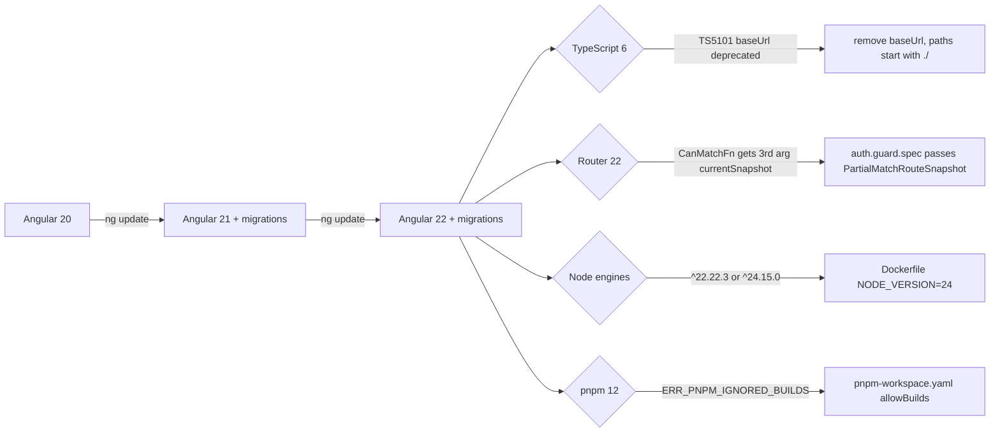

# Angular 22 upgrade — technical guide

## Versions

| Package | Before | Now (range) | Installed when verified |
|---------|--------|-------------|-------------------------|
| `@angular/*` (core, common, router, build, cli, ssr, cdk, …) | `^20.3.x` | `^22.2.3` (as in `zerobound-frontend`) | 22.3.0 |
| `@angular-devkit/build-angular` | `^20.3.22` | `^22.2.3` | 22.3.0 |
| `@ngrx/store`, `effects`, `store-devtools` | `^20` | `^22.0.1` | 22.0.1 |
| `zone.js` | `~0.15.0` | `~0.16.3` | 0.16.3 |
| `typescript` | `^5.7.3` | `~6.0.3` | 6.0.3 |
| Node (Dockerfile) | 22.14.0 | 24 | — |

`@ngx-translate/*` stays at 16 (peer `@angular/core >=16`). Tailwind is untouched.

The upgrade was done one major at a time with `ng update` (20 → 21 → 22), which also ran the automatic migrations over `src/` (about 120 file edits across both steps).

## Changes the upgrade forced

- `tsconfig.json`: `baseUrl` removed (deprecated in TS 6, error TS5101) and each `paths` target now starts with `./`. No code imported through `baseUrl`.
- `src/app/core/guards/auth.guard.spec.ts`: `CanMatchFn` takes a third argument in Angular 22; the spec passes `{} as PartialMatchRouteSnapshot`. The guard itself needs no change.
- `pnpm-workspace.yaml` (new): `allowBuilds` for `@parcel/watcher`, `bcrypt`, `esbuild`, `lmdb`, `msgpackr-extract`. It replaces `pnpm.onlyBuiltDependencies` of `package.json`, which pnpm 12 ignores.
- `Dockerfile`: Node 24 and `pnpm-workspace.yaml` copied into the install stages.

## Not changed on purpose

- Builders stay `@angular-devkit/build-angular` (deprecated webpack-based; Karma prints a deprecation notice). Moving to `@angular/build` (as zerobound does) is a separate change.
- `pnpm-lock.yaml` is git-ignored in this repo (existing decision); versions are resolved from the ranges.

## Verification

`ng build` (development and production), `ng run directory-frontend:server:production`, and `pnpm test`: 530 of 530 specs pass, before and after. Whole-project function coverage (Istanbul) is **49.71 %**, identical before and after; it is below the 85 % target, which is a pre-existing gap. The Docker image was not built here.
