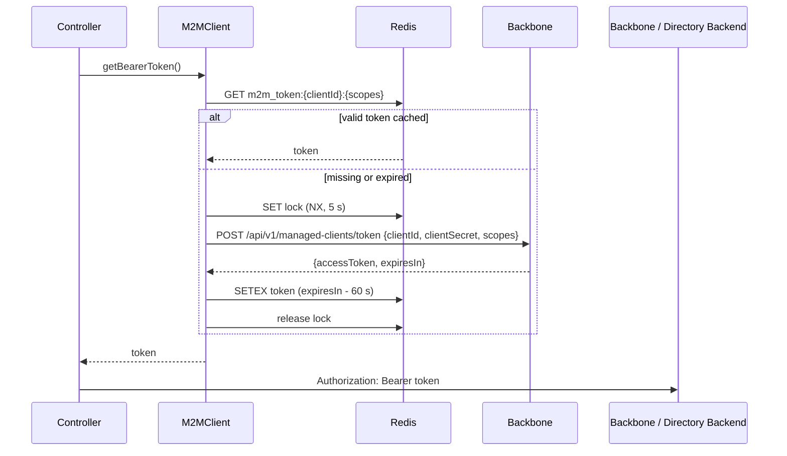

# BFF service token (M2M client) — technical guide

## Where it lives

| File | Role |
|---|---|
| `server/proxy/m2m-client.js` | `M2MClient`, `readM2MConfig`, `getM2MClient` (shared instance, `null` when not configured) |
| `server/proxy/oauth-client.js` | `getOAuthClient(config)` returns the M2M client when configured, otherwise the legacy Keycloak `OAuthClient` |
| `test/m2m-client.test.js` | Unit tests (`node --test`, script `pnpm test:bff`) |

The four callers (`backbone.controller`, `directory-backend-auth.controller` via `oauth-common-function`, `landing.controller`, `multimedia.controller`) are unchanged: they already call `getOAuthClient(config).getBearerToken()`, and both clients expose that method.

## Flow

## Behaviour

- **Request:** JSON `{clientId, clientSecret, scopes}`; answer `{accessToken, expiresIn}` (`access_token` / `expires_in` are accepted too). No `expiresIn` means 300 s.
- **Cache:** until one minute before `expiresIn`. The Redis key includes the scopes, so changing them never reuses an old token. Redis down or closed: memory cache only.
- **Concurrency:** calls inside one process share one in-flight request; across instances a Redis lock (`SET NX PX`) makes one fetch and the rest read its cache after 100 ms, falling back to fetching themselves.
- **Errors:** the failure is logged (message only) and rethrown; the next call tries again. `invalidate()` drops the cached token (use it after a 401 from a service).
- **Secrets:** the secret and the token are never logged; the configuration comes from the environment injected by Vault.

## Configuration

`M2M_CLIENT_ID`, `M2M_CLIENT_SECRET`, `M2M_TOKEN_URL` (all three needed) and optional `M2M_SCOPES` (comma separated). Without the three, `getM2MClient()` is `null` and the legacy client is used.

## Tests

`pnpm test:bff` runs 17 tests: request shape, snake_case and fallback life, expiry margin, parallel calls, Redis cache and key, lock take/release, lock held by another instance, Redis failures, `invalidate`, endpoint failure and recovery, configuration reading and the `getOAuthClient` switch. Function coverage of `m2m-client.js`: 94.44 %.
