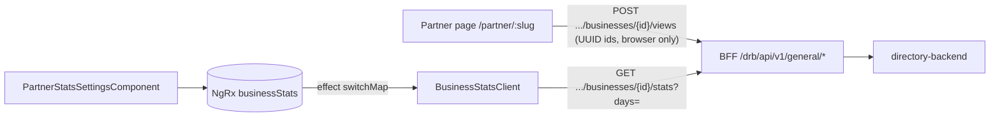

# Business statistics: views (technical guide)

## BFF
No change: the generic proxy forwards `/drb/api/v1/general/*` (all methods) to `/directory-backend/api/v1/*` and wraps the answer as `{headers, data}`, which `BusinessStatsClient` unwraps (`BffResponse<T>`).

| Frontend | Backend |
| --- | --- |
| `BusinessStatsClient.recordView(id)` | `POST /api/v1/businesses/{id}/views` (204; owner's views ignored) |
| `BusinessStatsClient.getStats(id, days)` | `GET /api/v1/businesses/{id}/stats?days=` (owner only; 401/403/404; days 1..365) |

## Pieces
- `businessStats` store: `businessId`, `days`, `stats`, `isLoading`, `error`. The effect uses `switchMap` (a quick change of window keeps the last answer); the reducer drops the numbers when the business changes; `selectMaxDailyViews` (at least 1) scales the bars.
- `PartnerStatsSettingsComponent` (`/partner/settings/stats`, `authGuard`): windows `STATS_WINDOWS = [7, 30, 90]`, business = `session.userAuth.businesses[0]`, bar height in percent of the busiest day (minimum 4 % for a day with views, 0 for none). Loading is skipped on the server (`// SSR: browser-only`).
- `Partner.recordView`: counts only in the browser and only when `isUuid(String(profile.id))`. `PartnerProfileService` still uses mock profiles with numeric ids (`useMockData = true`), so nothing is counted from the public page until it reads real businesses; this is the missing link of the feature.
- Settings card: `partner-settings.ts` option `chart` + icon in `partner-settings.html`.

## Tests
`business-stats.client`, `business-stats.store` (reducer, selectors, effects, service), `partner-stats-settings.component`, `uuid.helper`, and the view counting block of `partner.spec`.
Not covered: a real round trip through the BFF; the English and French texts await a human review.
