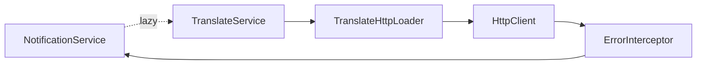

# Translations: es / en / fr (technical guide)

```mermaid
flowchart LR
    T[Templates: 'key' | translate] --> NG[ngx-translate]
    C[Code: translate.instant('key', params)] --> NG
    N[NotificationService: {key, params}] --> NG
    NG --> F[src/assets/i18n/es.json en.json fr.json]
    F --> P[i18n-parity.spec.ts - Karma]
    F --> K[scripts/i18n/check.mjs]
    I[scripts/i18n/inventory.mjs] -->|literal texts left| D[docs/guides/i18n-inventory.md]
    F --> R[scripts/i18n/review.mjs] --> V[docs/guides/i18n-review.md]
```

## Conventions
- Keys are `section.name` in snake_case (`auth.email_invalid`, `footer.copyright`, `validation.min_length`, `notifications.login_failed`); shared texts live in `common.*`. A key cannot be both a text and a group.
- Parameters are `{{name}}`; every language must use the same ones. In templates: `{{ 'footer.copyright' | translate: {year: autor.year, company: autor.company} }}`; a conditional text is a conditional key: `{{ (cond ? 'a.yes' : 'a.no') | translate }}`.
- Attributes: `[placeholder]`, `[alt]`, `[title]` and `[attr.aria-label]` bound to `'key' | translate`.
- Components that use the pipe import `TranslateModule` (standalone); their specs import `TranslateModule.forRoot({loader: {provide: TranslateLoader, useClass: TranslateFakeLoader}})` (the fake loader makes the pipe return the key, so a test asserts the key).
- Notifications: `notificationService.error({key: 'notifications.login_failed'})`; a plain string is shown as it is (backend messages). In code: `inject(TranslateService).instant(key, params)` (used by the form-validation messages).
- Development-only blocks are wrapped in `<!-- i18n-ignore:start ... --> ... <!-- i18n-ignore:end -->` and ignored by the inventory.

## Tooling (`scripts/i18n`, plain Node, no dependencies)
| Command | What it does |
| --- | --- |
| `pnpm run i18n:check` | Same keys in es/en/fr, no empty values, same `{{parameters}}`, and every key used in templates/code (`'k' \| translate`, `instant/get/stream('k')`, `{key: 'k'}`) is defined. Exit 1 on error. Lists keys not referenced (informational: some are used dynamically) |
| `pnpm run i18n:inventory` | Writes `docs/guides/i18n-inventory.md`: literal texts left in templates, inline templates and notifications, excluding the developer showcase and `i18n-ignore` blocks |
| `pnpm run i18n:review` | Writes `docs/guides/i18n-review.md` for the human review |
| Karma `i18n-parity.spec.ts` | The same parity rules inside `ng test` (`resolveJsonModule` enabled in `tsconfig.spec.json`) |

Every list the scripts sort (keys, files, `{{parameters}}`) uses the shared `byText` comparator of `lib.mjs` (`localeCompare` with a fixed `en` locale), so the generated sheets come out in the same order on every machine.

## Dependency order (NG0200)
`NotificationService` must not inject `TranslateService` eagerly: `TranslateHttpLoader` uses `HttpClient`, whose DI interceptors include `ErrorInterceptor`, which injects `NotificationService`. It resolves `TranslateService` with `injector.get(...)` only when it shows a message with a key (see the spec "circular dependency"). Do the same in any other class an interceptor depends on.



## Known limits
- Spanish is the default and the only language the UI uses today: there is no language selector yet (`TranslateService.use` is not wired to the interface).
- Sentences that contain links are split in fragments (`auth.register_terms_before / between`, `auth.login_terms_*`), so the word order of a fragment sentence must work in each language; check them in the review.
- `<svg>` elements have no `alt`: use `aria-label`/`title` (or `aria-hidden` when decorative), never `[alt]`.
- Text inside images, the landing/partner mock data and backend messages are not translated by this mechanism.
