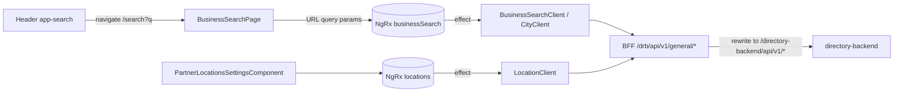

# Locations (sedes) and business search (technical guide)

## BFF
No new route. `server/routes/directory-backend-std.routes.js` forwards `/drb/api/v1/general/*` (all methods) and `config.json` rewrites it to `/directory-backend/api/v1/*`; the controller adds the session token. It wraps every answer as `{headers: {status, statusText}, data}` (`data` is `null` for an empty body, e.g. a 204), which `BffResponse<T>` models and the three clients unwrap.

| Frontend call | Backend |
| --- | --- |
| `CityClient.getCities(country?, q?)` | `GET /api/v1/cities` |
| `LocationClient.list/create/update/delete` | `GET/POST /api/v1/businesses/{id}/locations`, `PATCH/DELETE .../{locationId}` |
| `BusinessSearchClient.search(params)` | `GET /api/v1/businesses/search?city_id&category_id&q&page&per_page` |

## State
- `businessSearch`: `params`, results with `page/perPage/totalPages/totalCount`, `isSearching`, `searchError`, and the cities catalogue. The search effect uses `switchMap`, so an older answer never overwrites a newer one. `selectSearchIsEmpty` is true only after a finished, successful search without results.
- `locations`: `businessId`, `locations` (main first), `isLoading`, `isSaving`, `error`. Create, update and delete end in `saveLocationSuccess`, and an effect reloads the list because the backend may have moved the main location.

## UI
- `/search` (`features/business-search`): the URL is the source of truth (`paramsFromQuery`); filter changes navigate with `queryParamsHandling: 'merge'` and reset `page`. Pagination uses `per_page = 10`.
- `partner-locations-settings.component`: reactive form (city and address required, address not blank, length limits as in the backend: name 120, address 200, postal code 10, phone 30), the form closes when the save started from it ends without an error. Business = `session.userAuth.businesses[0]`.
- `Search` gained `@Input() initialValue`.

## SSR
Search and location loading are skipped on the server (`isPlatformBrowser`, marked `// SSR: browser-only`): they need the browser's session through the BFF.

## Tests
`city.client`, `location.client`, `business-search.client` (URLs, params, envelope, errors), `business-search.store` and `locations.store` (reducer, selectors, effects, store service), `business-search-page` (URL parsing, SSR guard, navigation, pagination, states), `partner-locations-settings.component` (load, validation, create/edit/main/delete, close on save), `header` and `search`.
Not covered: a real BFF round trip and the backend; the English/French texts await a human review.
